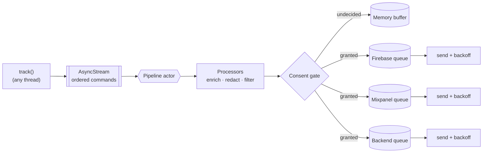

# Beacon

[](https://github.com/YOUR_USERNAME/Beacon/actions/workflows/ci.yml)


**A Swift analytics routing layer.** Track events once; Beacon fans them out to every vendor you're using, queues them offline, retries on failure, and keeps the consent layer between you and a GDPR headache.

```swift
let analytics = AnalyticsClient(
    providers: [FirebaseProvider(), MixpanelProvider(), HTTPBatchProvider(endpoint: collectorURL)],
    processors: [PIIRedactor(), PropertyEnricher(static: ["app_version": "3.2.0"])]
)

analytics.setConsent(granted: [.analytics])
analytics.track(.purchase(sku: "pro_yearly", price: 49.99))
```

Feature code calls one API. Which vendors receive events, what they're allowed to see, and what happens when the network is down are all decided in one place — not scattered across call sites.

## Features

- **Fan-out** — one `track` reaches every provider; swapping or adding a vendor is a one-line change
- **Consent layer** — events buffer in memory while the user hasn't decided yet; they never touch disk before consent, and withdrawing consent purges the queue immediately
- **Batching** — each provider has its own batch size and flushes on size, timer, or on demand
- **Offline persistence** — per-provider JSON Lines queues survive crashes and relaunches
- **Retries** — exponential backoff per provider, independently; one vendor being down doesn't hold up the others, and permanently bad batches get dropped rather than blocking the queue forever
- **Processing pipeline** — enrich properties, strip PII, filter noisy events, or sample before anything leaves the device
- **Sessions and identity** — automatic session IDs with an inactivity timeout; `identify` and `reset` for login and logout
- **Ordering** — events reach each provider in the order tracked, even across retries
- **Swift 6** — `track` is synchronous and callable from any thread or actor; all shared state lives in one actor

## Installation

```swift
dependencies: [
    .package(url: "https://github.com/YOUR_USERNAME/Beacon.git", from: "1.0.0"),
],
targets: [
    .target(name: "App", dependencies: ["Beacon"]),
    .testTarget(name: "AppTests", dependencies: [.product(name: "BeaconTesting", package: "Beacon")]),
]
```

## Usage

### Define events in one place

```swift
extension AnalyticsEvent {
    static func purchase(sku: String, price: Double) -> AnalyticsEvent {
        AnalyticsEvent("purchase_completed", properties: ["sku": .string(sku), "price": .double(price)])
    }

    static let onboardingCompleted = AnalyticsEvent("onboarding_completed")
}

analytics.track(.purchase(sku: "pro_yearly", price: 49.99))
analytics.track(.screenView("Settings"))
analytics.track("share_tapped", properties: ["channel": "whatsapp"])
```

### Adapt your vendors

Beacon has no vendor dependencies; an adapter is a few lines in your app.

```swift
import FirebaseAnalytics

struct FirebaseProvider: AnalyticsProvider {
    let id = "firebase"
    let maxBatchSize = 20

    func send(_ events: [AnalyticsEvent]) async throws {
        for event in events {
            Analytics.logEvent(event.name, parameters: event.properties.anyValues)
        }
    }

    func identify(userID: String, traits: [String: AnalyticsValue]) async {
        Analytics.setUserID(userID)
    }

    func reset() async {
        Analytics.setUserID(nil)
    }
}

struct AdAttributionProvider: AnalyticsProvider {
    let id = "attribution"
    var consentCategory: ConsentCategory { .marketing } // only with marketing consent
    func send(_ events: [AnalyticsEvent]) async throws { … }
}
```

Built in: `HTTPBatchProvider` (your own collector endpoint) and `ConsoleProvider` (debug logging).

### Consent

```swift
// Before the user answers, events are buffered in memory only.
analytics.track("app_open")

// From your consent banner:
analytics.setConsent(granted: [.analytics])           // product analytics only
analytics.setConsent(granted: ConsentCategory.allOptional) // accept all
analytics.setConsent(granted: [])                       // reject all; queued data is deleted
```

| Event category | Provider category | Delivered? |
|---|---|---|
| `.analytics` | `.analytics` | Only if the user granted `.analytics` |
| `.analytics` | `.marketing` | Only if the user granted both |
| `.necessary` | `.necessary` | Always |

The decision is persisted, so the banner only needs to show once.

### Processing

```swift
AnalyticsClient(
    providers: providers,
    processors: [
        PropertyEnricher { ["is_logged_in": .bool(Session.shared.isLoggedIn)] },
        PIIRedactor(),                                  // emails, phone numbers, sensitive keys
        EventFilter(blocking: ["scroll_depth"]),        // silence a noisy event
        ClosureProcessor { event in                     // anything else
            event.name.hasPrefix("debug_") ? nil : event
        },
    ]
)
```

### Flushing on background

```swift
.onChange(of: scenePhase) { _, phase in
    if phase == .background {
        Task { await analytics.flush() }
    }
}
```

### Testing your analytics

```swift
import BeaconTesting

@Test func purchaseIsTracked() async {
    let provider = RecordingProvider()
    let analytics = AnalyticsClient(
        providers: [provider],
        store: InMemoryEventStore(),
        consentStorage: InMemoryConsentStorage(),
        configuration: .init(flushInterval: nil, defaultConsent: .decided(granted: [.analytics]))
    )

    CheckoutModel(analytics: analytics).buy("pro_yearly")
    await analytics.flush()

    #expect(await provider.eventNames == ["purchase_completed"])
}
```

## Architecture



## Design decisions

**AsyncStream in front of an actor.** The obvious approach — `Task { await pipeline.track(event) }` per call — doesn't actually preserve order. Two unstructured tasks can interleave. Yielding into a stream is synchronous and ordered, and a single consumer drives the actor, so `track` stays non-blocking *and* events arrive in the right order.

**One queue per provider.** Vendors have different batch limits and different uptime. A Mixpanel outage shouldn't hold up Firebase events, and a Firebase quota error shouldn't delay your backend collector. Each queue retries independently with its own backoff.

**Remove by event ID after sending.** The actor is reentrant — while a batch is in flight, new events keep arriving and consent can change. Removing by ID (instead of "the first N items") keeps the queue correct across suspension points regardless of what arrived mid-send.

**One batch in flight per provider.** Launching two concurrent sends to the same vendor could deliver batch 2 before batch 1. If a flush is already running, new callers await it instead of starting another.

**BatchRejectedError for permanent failures.** A provider can signal that a batch is bad and retrying won't help (e.g. HTTP 400). Beacon drops those rather than retrying forever, so one malformed event can't block everything behind it.

**JSON Lines on disk.** Each event is one line. Appending is O(1) and a crash mid-write corrupts at most one line, which gets skipped on load.

**Consent before persistence.** Undecided events stay in memory only — they never reach disk. A user who declines leaves no trace, and withdrawal immediately clears queued events across every provider.

**Bounded queues.** Queue size, event age, and the undecided buffer are all capped. A device that's been offline for a month won't quietly fill storage when it reconnects.

**No vendor dependencies.** Adapters live in the app, not in Beacon. You control SDK versions and don't pull in transitive dependencies you didn't ask for.

## Requirements

- Swift 6.0+ / Xcode 16+
- iOS 16+, macOS 13+, tvOS 16+, watchOS 9+, visionOS 1+

## Roadmap

- [ ] Sampling processor (deterministic per user)
- [ ] `BGTaskScheduler` integration for background delivery
- [ ] Debug overlay showing the live event stream
- [ ] Typed event schemas with a macro

## License

MIT. See [LICENSE](LICENSE).
